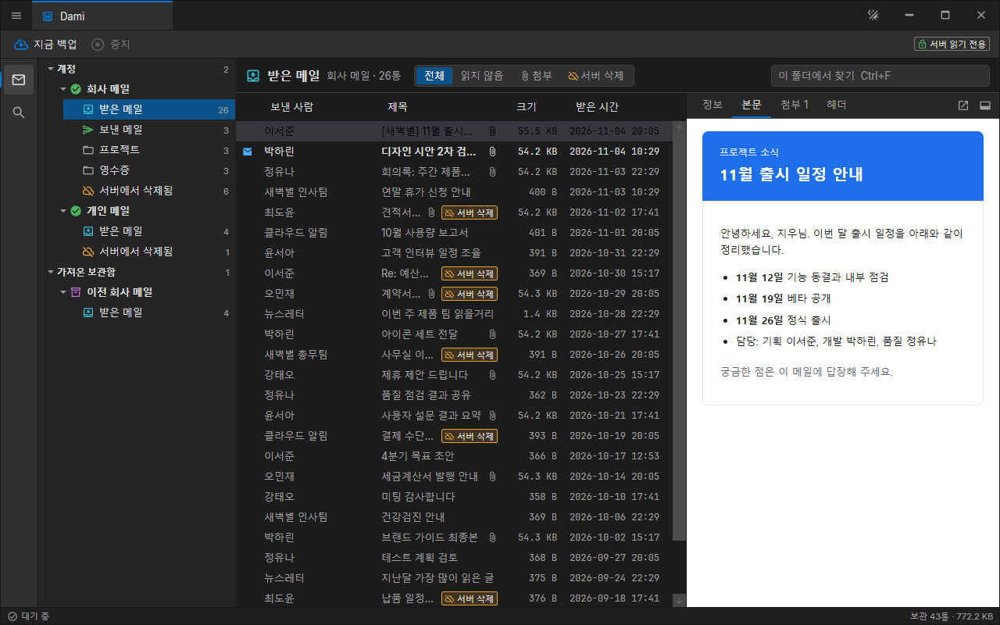
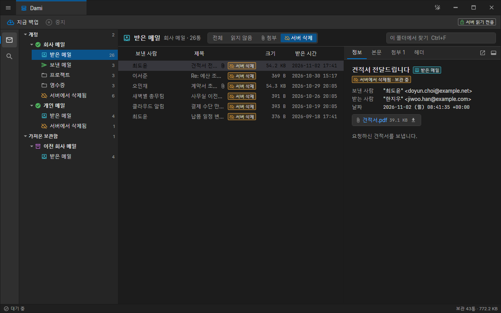
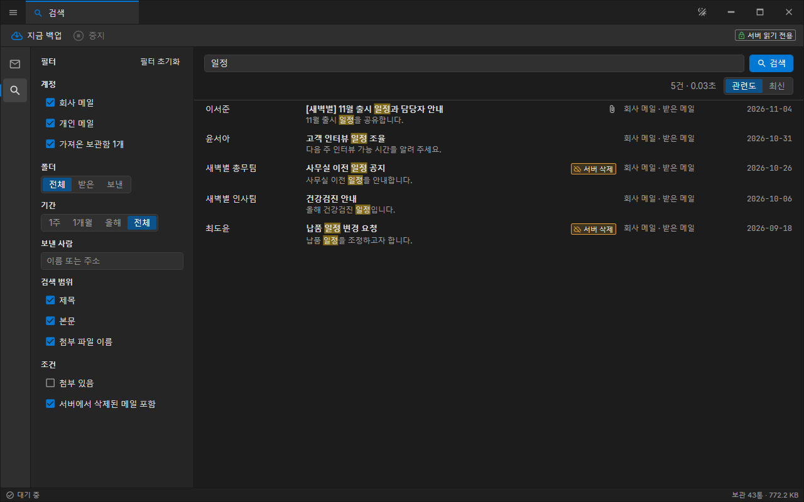
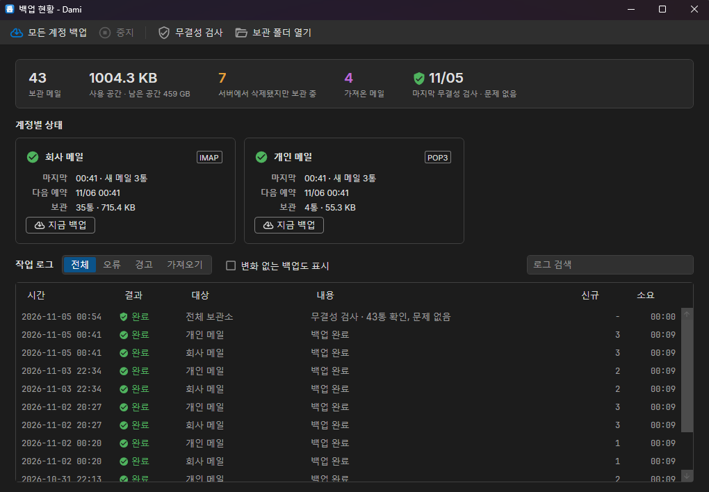
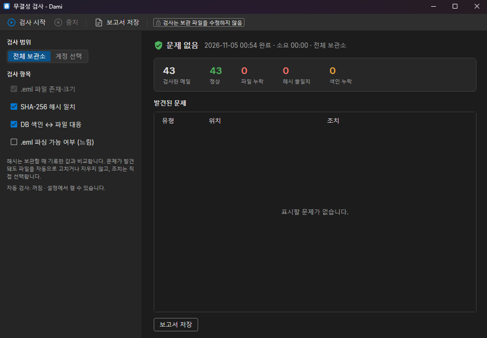
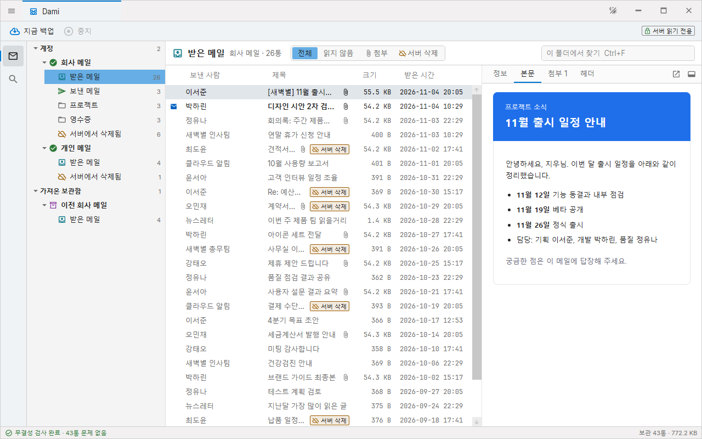

# Dami

**서버에서 지워져도 남는 메일 보관함**

IMAP · POP3 메일을 내 PC에 영구 보관하는 Windows 프로그램입니다.

[**최신 버전 다운로드**](https://github.com/gaurilabs/dami/releases/latest)

## 왜 Dami인가요?

메일함 용량이 차서 지운 메일, 서버 보관 기간이 지나 사라진 메일, 퇴사나 서비스 종료로 접근할 수 없게 된 메일은 다시 찾기 어렵습니다.

Dami는 메일을 원본 그대로 내 PC에 쌓아 둡니다. **서버에서 메일이 지워져도 Dami에는 남고, Dami가 서버의 메일을 지우거나 바꾸는 일도 없습니다.**

## 주요 기능

### 지워져도 남습니다

서버에서 사라진 메일은 삭제하지 않고 `서버 삭제` 표시와 함께 계속 보관합니다. 계정마다 `서버에서 삭제됨` 폴더로 모아 볼 수 있습니다.

### 서버는 읽기만 합니다

- IMAP은 읽기 전용으로 접속하고, 메일을 읽음으로 표시하지도 않습니다.
- POP3는 서버의 메일을 지우는 명령을 쓰지 않습니다.
- 메일은 받은 원본 그대로 `.eml` 파일로 저장합니다.

### 빠른 전체 검색

보관한 메일의 제목, 본문, 첨부 파일 이름을 계정과 기간에 상관없이 한 번에 찾습니다. 한글 검색을 지원합니다.

### 예약 백업과 현황

계정마다 주기를 정해 자동으로 백업합니다. 창을 닫아도 트레이에서 계속 동작하고, 전체 현황과 작업 기록을 한눈에 확인할 수 있습니다.

### 무결성 검사

보관한 파일이 그대로인지 SHA-256 해시로 검사합니다. 문제가 있어도 자동으로 고치거나 지우지 않으며, 사본에서 복원하거나 서버에서 다시 받는 조치를 직접 고를 수 있습니다.

### 가져오기와 내보내기

- **가져오기:** EML, MSG, MBOX, Thunderbird 로컬 폴더, Gmail Takeout, Outlook PST·OST
- **내보내기:** EML(원본 그대로), MBOX

이전에 쓰던 메일 프로그램의 보관 파일도 하나의 보관소로 모을 수 있습니다.

### 그 밖의 기능

- 다크·라이트 테마
- 메일 본문의 스크립트 항상 차단, 외부 이미지 기본 차단
- 보관소를 다른 드라이브로 이동
- 새 버전 자동 확인과 업데이트

## 설치

1. [Releases](https://github.com/gaurilabs/dami/releases/latest)에서 `Dami_<버전>_win-x64_setup.exe`를 받습니다.
2. 설치 파일을 실행합니다. 관리자 권한은 필요 없습니다.
3. Dami를 실행하고 메일 계정을 추가합니다.

> 설치 파일에 코드 서명이 없어 Windows SmartScreen 경고가 나올 수 있습니다. 그때는 **추가 정보 → 실행**을 누르면 됩니다.

v1.1.0부터는 새 버전이 나오면 앱에서 안내하고, 승인하면 자동으로 업데이트합니다.

### 시스템 요구 사항

| 항목 | 내용 |
|------|------|
| 운영체제 | Windows 10 1809 이상, Windows 11 (x64) |
| 런타임 | 설치 파일에 포함 |
| 메일 본문 표시 | WebView2 런타임 (Windows 10·11에 대부분 기본 설치) |

## 알아 두세요

- **계정 연결:** 메일 서비스의 앱 비밀번호로 연결합니다. OAuth 로그인은 지원하지 않습니다.
- **비밀번호:** Windows 사용자 계정에 묶인 DPAPI로 암호화해 저장합니다.
- **데이터 위치:** `%LOCALAPPDATA%\Dami`에 저장하며, 설정에서 옮길 수 있습니다.
- **제거해도 메일은 남습니다:** 프로그램을 제거해도 보관소와 설정은 지우지 않습니다.
- **외부 연결:** 메일 서버와, 새 버전 확인을 위한 GitHub에만 연결합니다. 새 버전 자동 확인은 설정에서 끌 수 있습니다.

## 문의

버그 제보와 제안은 [Issues](https://github.com/gaurilabs/dami/issues)에 남겨 주세요.

## 라이선스

Dami는 MIT 라이선스로 배포합니다. 이 저장소는 배포 전용이며 소스 코드는 공개하지 않습니다.

---

화면의 계정, 인물, 메일은 모두 설명을 위한 가상 데이터입니다.

Copyright © 2026 GauriLab. All rights reserved.
